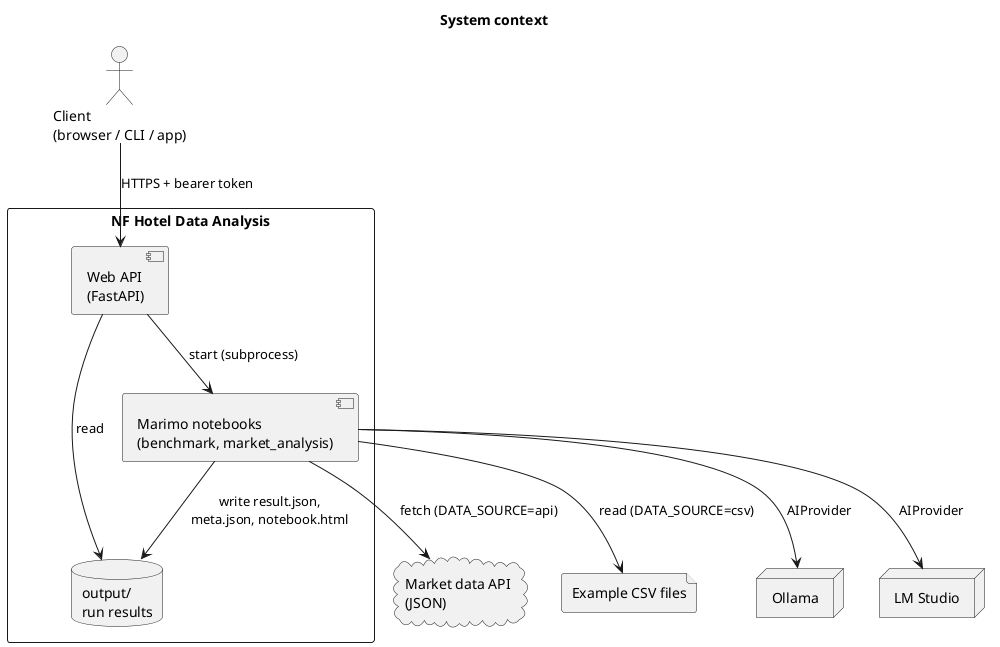
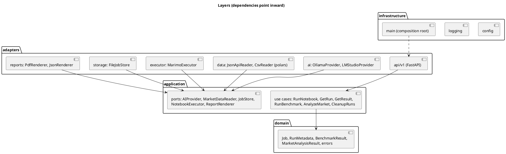
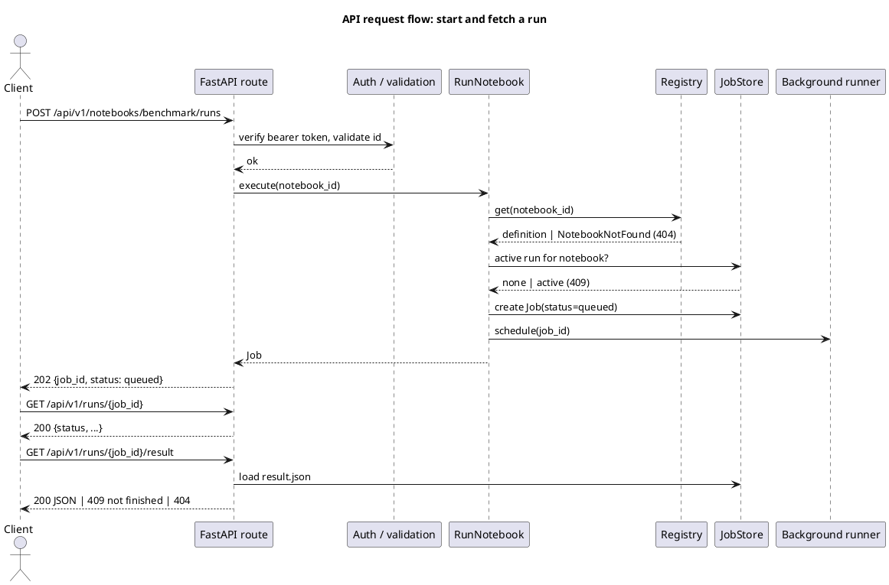
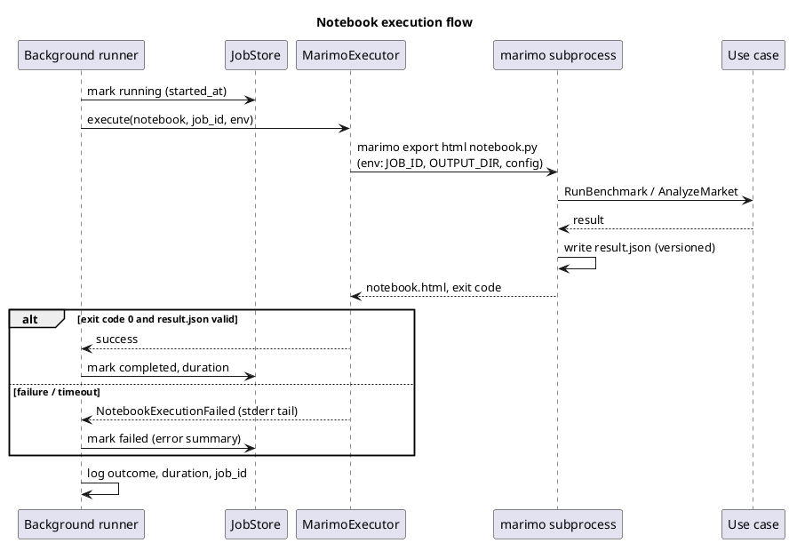
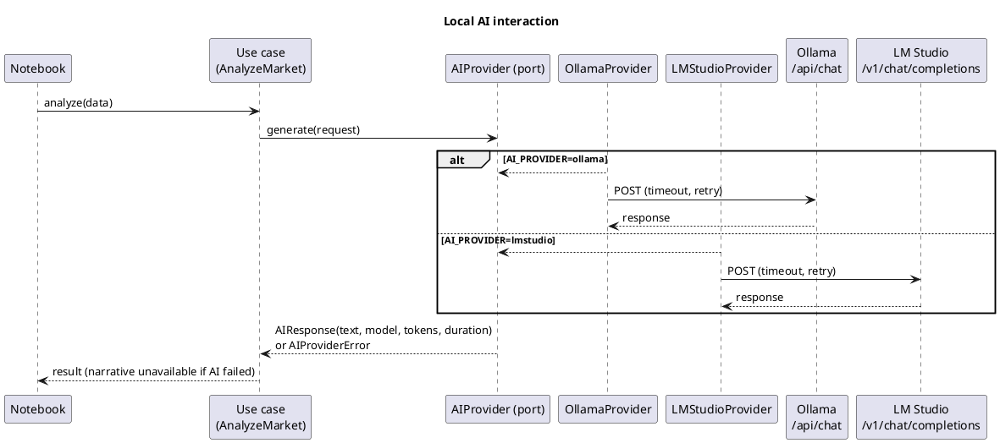
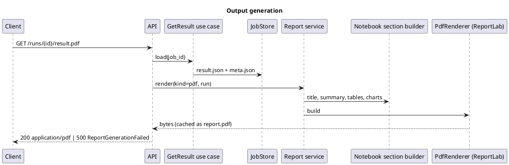
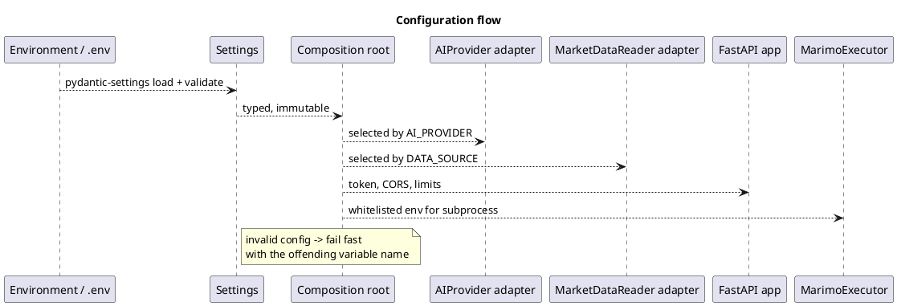

# Architecture

Diagrams are PlantUML in fenced `plantuml` blocks (rendered by Gitea).

## 1. System context

## 2. Layers and components

Dependencies point inward only. Enforced with `import-linter`.

### Components and responsibilities

| Component | Responsibility |
|---|---|
| `domain` | Frozen dataclasses (`Job`, `RunMetadata`, per-notebook result types) and domain errors. No I/O, no third-party imports. |
| `application` | Use cases and ports. Orchestrates domain logic; knows nothing about HTTP, files, polars or Marimo. |
| `adapters/api` | FastAPI routes, Pydantic schemas, auth dependency, error handlers. Thin: parse, call use case, respond. |
| `adapters/executor` | Starts a notebook subprocess with timeout and captures output. |
| `adapters/storage` | Stores runs in `output/<job_id>/`; implements retention. |
| `adapters/ai` | One class per provider implementing `AIProvider`. |
| `adapters/data` | Market data readers (polars) converting to domain types. |
| `adapters/reports` | JSON and PDF renderers. |
| `infrastructure` | Settings, logging setup, composition root. |
| `notebooks/` | Marimo files: build dependencies from config, call one use case, present the result. |

### Notebook registry

A registry of approved notebooks in the application layer. Each entry declares: `notebook_id`, file path (relative to `notebooks/`, fixed in code), input schema, result schema, report section builder, and default timeout. Clients pass only `notebook_id`.

## 3. API request flow

## 4. Notebook execution flow

Notes:
- Execution uses Marimo's headless HTML export, which runs the notebook and produces `notebook.html`; the notebook also writes `result.json` as a side effect. **This must be verified in a spike before Phase 5**, including how parameters reach the notebook (environment variables are the planned mechanism) and how `--no-include-code` and error exit codes behave.
- The subprocess gets a minimal environment: only the variables it needs, and no unrelated secrets.
- On timeout the whole process tree is terminated (Windows requires explicit tree kill).
- Concurrency: an `asyncio.Semaphore(MAX_CONCURRENT_RUNS)` plus one active run per notebook.

## 5. Local AI interaction

`AIProvider` exposes `generate(request) -> AIResponse` and `list_models() -> list[str]`. Error types: `AIProviderUnavailable`, `ModelNotLoaded`, `AIProviderTimeout`, `AIInvalidResponse`. The chosen provider is created once in the composition root from `AI_PROVIDER`; the benchmark can create several.

## 6. Data flow

1. **Input:** `MarketDataReader` returns domain objects, from the JSON API (`DATA_SOURCE=api`) or CSV (`csv`). Polars is used inside the readers only.
2. **Processing:** the `AnalyzeMarket` use case computes metrics on domain objects and asks `AIProvider` for narrative text.
3. **Result:** a versioned, typed result is serialized to `result.json`.
4. **Output:** the report service renders JSON, PDF (cached in the run folder) and serves `notebook.html`.

## 7. Output generation flow

The report service knows nothing about Marimo. Each registered notebook supplies a section builder that converts its typed result into generic blocks (heading, paragraph, table, chart); the PDF renderer only renders blocks. New notebooks therefore need no renderer changes.

## 8. Error handling flow

Domain errors are raised in use cases and adapters and mapped in a single FastAPI exception handler:

| Error | HTTP |
|---|---|
| `InvalidRequest` / validation | 400 / 422 |
| Missing or invalid token | 401 |
| `NotebookNotFound`, `RunNotFound` | 404 |
| `RunAlreadyActive`, result requested before completion | 409 |
| `AIProviderUnavailable`, `ModelNotLoaded`, `AIProviderTimeout` | 503 |
| `NotebookExecutionFailed`, `ReportGenerationFailed`, unexpected | 500 |

Clients receive `{"error": {"code": "...", "message": "...", "correlation_id": "..."}}`. Full details and stack traces are logged with the same `correlation_id`. Failures inside a running job are recorded on the job (`status=failed`, sanitized `error`) and never crash the API process.

## 9. Configuration flow

The notebook subprocess builds its own `Settings` and dependencies from its environment, using the same composition code as the API.

## 10. Retention

A cleanup use case runs at startup and then daily. It deletes run folders older than `RETENTION_DAYS` (7), except the latest run and the latest successful run of each notebook. Deletion only touches direct children of `OUTPUT_DIRECTORY` whose names are valid UUIDs.

## 11. Security summary

- Only registered notebook ids can run; no client-supplied paths, code or arguments.
- `job_id` is parsed as a UUID before use in any path; resolved paths are checked to stay inside `OUTPUT_DIRECTORY`.
- Bearer token compared in constant time; `/health` is the only unauthenticated endpoint.
- CORS uses an explicit origin list, no wildcard in production.
- Request body size and run-start rate are limited.
- Secrets are never logged; the stored configuration snapshot omits them.
- Production requires `API_TOKEN` and explicit CORS origins, or startup fails.

## 12. Extensibility

- **New notebook:** notebook file, registry entry, input and result schemas, section builder, tests, `docs/api.md` entry. Routes, runner and store are unchanged.
- **New AI provider:** one adapter implementing `AIProvider`, a config value, tests. Notebooks and use cases are unchanged.
- **New data source:** one adapter implementing `MarketDataReader`.
- **Real job queue:** replace the background runner behind `NotebookExecutor`/`JobStore`.

## 13. Differences from the initial proposal

- The layered structure replaces `api / notebooks / services / ai` so dependency direction can be enforced (ADR-001).
- Runs are a resource (`/runs/{job_id}`) rather than one result per notebook, so history and concurrent inspection work (ADR-005, ADR-006).
- The "Notebook Registry / Notebook Runner / Service Layer" boxes map to: registry and use cases in `application`, runner in `adapters/executor`, services split into use cases and adapters.
