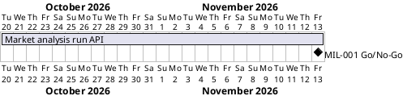

# Project Plan

## Metadata
| Key | Value |
| --- | --- |
| ID | PP-001 |
| CrossReference | [BC-001], [SA-001], [MIL-001] |
| Language | en |
| Domain | it |

## Version History
| Date | Status | Author | Reviewer | Change | Commit |
| --- | --- | --- | --- | --- | --- |
| 2026-10-20 | Proposed | Claude (AI) | S02 | Initial version | [34f6b14] |

---

## Purpose

Schedules the phases that give the market analysis service its run API, within the Business Case constraint of a target date of 2026-11-13 for the run API ([BC-001]).

## Planning Assumptions

- The plan starts 2026-10-20, the day the Business Case was accepted.
- One phase, about three weeks of part-time work by S01's team with AI help.
- S02 reviews and accepts; the AI reviews at the request of the user and says so on every record.
- The web application (NFHotel MIL-026) follows this phase; its dates are in the NFHotel Project Plan.

## Gateway Schedule

| Gateway | Document | Window | Decision date | Owner | Stories | Main deliverable | Milestone |
| --- | --- | --- | --- | --- | --- | --- | --- |
| Market analysis run API | [MIL-001] | 2026-10-20 to 2026-11-13 | 2026-11-13 | S01 | NFHotel US-001.01 | Contract, six analyses, AI insights, run API, image | |

## Scope Coverage

| Business Case scope item | Gateway |
| --- | --- |
| The run API, its contract, its key, its background run and its stored result | [MIL-001] |
| The six analyses and the AI insights with a guardrail | [MIL-001] |
| The image and the compose file | [MIL-001] |

## Dependencies

The phase has no earlier phase. A No-Go keeps the web application on its failing release check (NFHotel pull request 180) and moves NFHotel MIL-026 tasks 13 to 16 back by the same time.

## Plan Risks

| Risk | Mitigation |
| --- | --- |
| The local model is too slow for the 12 minute run | A run can ask for no insights; the numbers are returned without them |
| The web application's tasks 13 to 16 wait for this phase | The contract is agreed in task 1, so the client can be built against a fake in parallel |
| The framework checklists in `framework/qc` were copied, not mounted | Re-initialise `framework/` as a submodule before the first pull request |

## Open Issues

- Confirm the target date 2026-11-13 (S01).
- The Project Plan has no QC checklist; S01 accepts it.

---

[BC-001]: ./business-case.md
[SA-001]: ./stakeholder-analysis.md
[MIL-001]: ./milestones/mil-001-market-analysis-run-api.md
[34f6b14]: https://github.com/NF-Hotel/notebook-market-analysis/commit/34f6b14a776ce9c75294979f88563378287839bf
